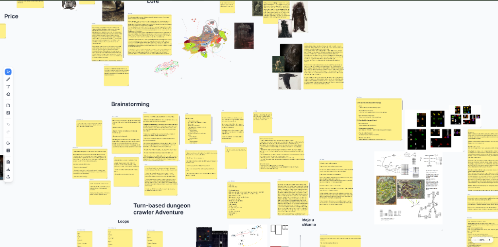

# 🧠 Brainstorm Board

An intuitive, lightweight infinite-canvas whiteboard and brainstorming application for the web. Built with React 19, perfect-freehand ink simulation, and self-contained zero-dependency bundling.

### 🌐 Try Online: [https://milospavlovic7.github.io/brainstorm_board_app/](https://milospavlovic7.github.io/brainstorm_board_app/)



---

## ✨ Key Features

- **Infinite Interactive Canvas**: Pan freely and zoom smoothly across an unbounded creative space.
- **Rich Sticky Notes**: Add colorful sticky notes with customizable typography, font sizes, weights, and text colors.
- **Natural Freehand Inking**: Pressure-sensitive, fluid vector drawing powered by [`perfect-freehand`](https://github.com/steveruizok/perfect-freehand).
- **Text & Annotations**: Place inline typography and headers anywhere on the board.
- **Image Insertion**: Drag-and-drop or upload images directly onto the canvas with automatic aspect ratio scaling.
- **Precision Eraser**: Effortlessly remove strokes, notes, and elements with surgical accuracy.
- **Theme & Grid Support**: Toggle between Dark Mode and Light Mode, with an optional dot-grid background for alignment.
- **History & Recovery**: Full undo (`Ctrl+Z`) and redo (`Ctrl+Y` / `Ctrl+Shift+Z`) operation stack.
- **Zero-Cloud Local Storage**: Automatic state persistence to browser `localStorage` plus manual JSON export/import for easy backups.
- **Single-File Self-Contained**: Builds to a single standalone HTML bundle that runs completely offline with no backend required.

---

## 🎮 Controls & Shortcuts

- **Pan Canvas**: Hold `Middle Click` / `Space + Drag` or use the navigation tool.
- **Zoom**: Mouse Wheel (`Scroll Up` to zoom in, `Scroll Down` to zoom out) or bottom-right zoom controls.
- **Select & Move**: Click and drag any card, note, or element to reposition it.
- **Undo**: `Ctrl + Z`
- **Redo**: `Ctrl + Y` or `Ctrl + Shift + Z`
- **Delete Selected**: Select an item and press `Delete` or `Backspace`.
- **Export Board**: Save current workspace to `.json` from the top navigation bar.
- **Import Board**: Load any previously exported board file.

---

## 🚀 Quick Start

### Option 1: Use Online (No installation required)
Launch the board instantly in your browser:  
👉 **[https://milospavlovic7.github.io/brainstorm_board_app/](https://milospavlovic7.github.io/brainstorm_board_app/)**

### Option 2: Run Standalone Offline
Open `dist/index.html` directly in any web browser. It is fully compiled into a self-contained file with all scripts and styles inlined.

### Option 3: Local Development
```bash
# Clone the repository
git clone https://github.com/milospavlovic7/brainstorm_board_app.git
cd brainstorm_board_app

# Install dependencies
npm install

# Start local dev server
npm run dev
```
Open [http://localhost:5173](http://localhost:5173) in your browser.

### Option 4: Production Build
```bash
npm run build
```
The compiled single-file bundle will be output to `dist/index.html`.

---

## 🛠️ Tech Stack

- **Framework**: [React 19](https://react.dev/)
- **Build Tool**: [Vite 8](https://vitejs.dev/) + [`vite-plugin-singlefile`](https://github.com/richardtallent/vite-plugin-singlefile)
- **Styling**: Tailwind CSS & Modern CSS Custom Properties
- **Ink Engine**: [perfect-freehand](https://github.com/steveruizok/perfect-freehand)
- **Icons**: [Lucide React](https://lucide.dev/)
- **State Management**: React Context & Reducer with persistent LocalStorage

---

## 📜 License

MIT License. Free for personal, educational, and commercial use.
